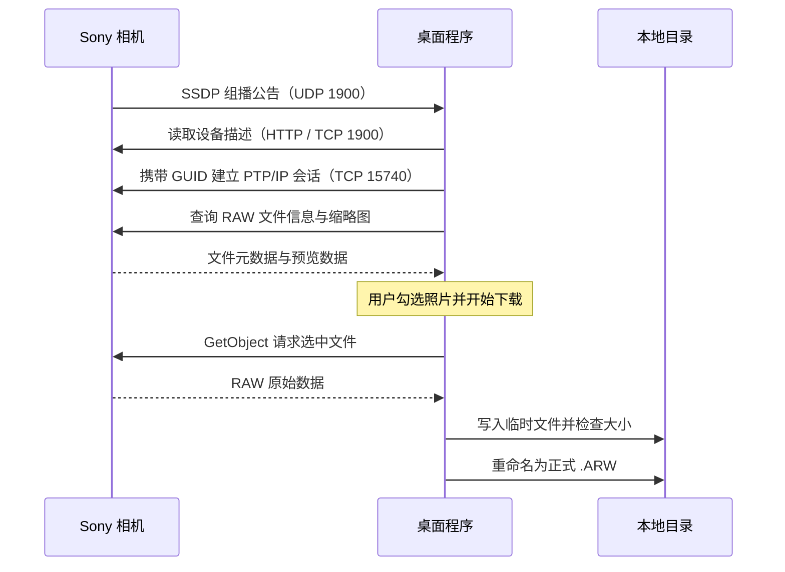

# Sony RAW Gallery

在 Windows 上，通过 Wi-Fi 浏览 Sony 相机里的 RAW 照片，勾选后下载原始 `.ARW` 文件。

连接相机、查看缩略图、筛选拍摄日期、多选下载，都可以在同一个桌面窗口中完成。照片在相机与电脑之间通过局域网传输。

## 功能

- **自动发现相机**，也可以手动填写 IP 地址。
- **RAW 缩略图浏览**，双击卡片打开放大的缩略图预览。
- **多选下载**，支持全选、清空选择和选择尚未下载的照片。
- **按拍摄日期筛选**，例如仅加载最近 5 个自然日的照片。
- **下载进度显示**，查看当前文件和所选文件的总字节进度。
- **跳过已有文件**，本地同名文件与相机文件大小一致时跳过。
- **安全取消**，停止保存，等待当前协议请求结束后回到选片界面。
- **设置记忆**，保存目录、日期范围、手填 IP 和 GUID 会保存在当前 Windows 用户的应用设置中。

## 兼容范围

| 项目 | 当前情况 |
| --- | --- |
| 操作系统 | Windows |
| 相机 | Sony α6400 / ILCE-6400 已完成核心连接和 RAW 下载实测 |
| 文件格式 | `.ARW` |
| 连接方式 | 相机的「发送至电脑 / Send to Computer」功能 |
| 窗口 | PySide6 / Qt |
| 传输实现 | Python 标准库，直接实现 PTP/IP |

窗口组件已经过本地与模拟回包测试。缩略图接口、长时间连续操作和取消行为仍需结合相机实测。其他 Sony 型号需要自行验证，带有 Wi-Fi 的相机也可能采用不同的传输流程。

## 快速开始

### 1. 准备文件

将以下两个文件放在同一目录。

```text
SonyRawGallery/
├── sony_raw_gallery.py    # 桌面窗口
└── sony_camera.py         # 自动发现、会话与文件传输
```

### 2. 启动程序

安装 [uv](https://docs.astral.sh/uv/getting-started/installation/) 后，在上述目录打开 PowerShell，执行下面的命令。uv 会根据脚本头部声明安装所需的窗口依赖。

```powershell
uv run .\sony_raw_gallery.py
```

如果已经安装 Python 3.11 或更新版本，也可以创建虚拟环境并手动安装依赖。

```powershell
python -m venv .venv
.\.venv\Scripts\python.exe -m pip install "PySide6-Essentials>=6.8,<7"
.\.venv\Scripts\python.exe .\sony_raw_gallery.py
```

当前构建排查中，Python 3.13 与 PySide6 6.8.3 已通过窗口构造测试。若遇到 Qt DLL 加载错误，可以在独立环境中验证这一组合。

### 3. 完成相机配对

首次使用「发送至电脑」功能，需要通过 USB 给相机登记接收端 GUID。可以使用 PlayMemories Home 的无线导入设置，或了解下方参考项目提供的 GUID 设置工具。

**GUID 必须与相机已登记的值一致。当前源码中的默认 GUID 来自开发测试环境，使用自己的相机时需要核对并填写对应值。**

对于 PlayMemories Home 注册，sony-pm-alt 项目记录了一种由电脑联网网卡 MAC 地址推导 GUID 的方式。例如，MAC 为 `AA-BB-CC-DD-EE-FF` 时，对应值为下列形式。

```text
00:00:00:00:00:00:00:00:ff:ff:aa:bb:cc:dd:ee:ff
```

相机 IP 用来确定连接地址，GUID 用于 PTP/IP 初始握手。换网络后需要重新发现相机地址，并核对配对记录是否仍保留。

### 4. 连接并选片

1. 将电脑和相机连接到同一个允许设备互访的局域网。
2. 在窗口中填写匹配的 GUID。IP 可以留空以自动发现。
3. 如需日期筛选，先设置天数。`0` 表示全部日期，`5` 表示今天和前四天。
4. 点击「连接并加载照片」，随后在相机上选择「发送至电脑」。
5. 等待照片卡片加载，勾选要保存的照片。双击可查看缩略图预览。
6. 选择本地保存目录，点击「下载勾选照片」。

首次使用时，Windows 可能询问防火墙访问权限。家庭局域网使用专用网络配置，并允许对应的 Python 或应用接收局域网发现消息。

## 使用细节

### 日期筛选

筛选读取相机返回的拍摄日期，并以电脑当天日期计算最近 N 个自然日。更改天数后，点击「连接并加载照片」刷新列表。

选择最近 N 天时，拍摄日期缺失、无效或超出范围的文件会被跳过。相机时间设置会影响筛选结果。

### 缩略图

程序使用相机的 PTP `GetThumb` 操作读取预览，避免为了浏览就下载整张 RAW。双击显示的是放大的相机缩略图。

部分相机或文件可能没有可用缩略图。这些文件会保留文件名卡片，仍可勾选下载。

### 已有文件与临时文件

下载时会先创建独立的 `.part` 临时文件。完整接收并核对大小后，才改为正式的 `.ARW` 文件名。

- 同名且大小一致的正式文件会跳过。
- 同名但大小不同会报告错误，请检查文件或更换保存目录。
- 网络异常留下的 `.part` 会保留，重试时从头下载。
- 主动取消会清理本次取消产生的临时文件，之前已经完成的照片会保留。

当前去重依据是文件名和大小。换卡、相机编号重新循环等情况可能产生同名同大小的不同照片，建议使用独立保存目录。

### 取消与连接

点击「取消本次任务」后，程序会停止保存，并接收、丢弃当前请求的剩余数据，再保留连接返回可操作状态。因此，取消可能需要等待当前文件传输收尾。

等待自动发现时可以取消。TCP 连接或握手阶段可能需要等待网络超时。出现网络错误、相机主动退出或会话失步时，程序会关闭失效连接。请在相机上退出并重新选择「发送至电脑」，再重新加载照片。

## 工作原理



相机先公告服务可用，程序再主动连接相机读取照片。获取设备描述成功被用作发起握手的时机信号；实测尚不能确定该 HTTP 请求是否是相机每次接受连接的必需步骤。

## 常见问题

### 一直等待相机

确认相机和电脑位于可互访的局域网，点击连接后重新进入相机的「发送至电脑」。访客网络、客户端隔离、防火墙、多网卡或 VPN 可能影响组播发现。

也可以从路由器客户端列表确认相机 IP，填入窗口后再连接，单独验证直连路径。

### 握手超时

请核对 GUID，并确认相机仍在当前这轮「发送至电脑」状态。关闭其他正在尝试接收的程序，再重新发起一轮连接。

在 α6400 的开发测试中，Windows 的 `WUDFHost` 曾主动连接相机 TCP 15740 端口。若反复出现接收端竞争，可以检查 PlayMemories Home 及 Windows 便携设备的连接情况。

### 下载时看起来停住

关注窗口的字节进度。RAW 文件较大，速度取决于相机 Wi-Fi、信号和网络环境。只有写入完成并通过大小检查后，文件才会显示为正式 `.ARW`。

### EXE 被 Windows 拦截

自行构建的 EXE 可能因缺少受信任签名或应用程序控制策略被阻止。具体处理取决于 SmartScreen、Smart App Control 或组织管理策略，请先确认提示来源。源码启动方式可用于继续排查。

### 导入 QtCore 时提示 DLL 加载失败

确认 PySide6 安装在实际使用的 Python 环境中。如果源码可以启动，而 EXE 报错，应检查打包时 Qt、Shiboken、Python 运行库的版本和 DLL 搜索路径。EXE 的运行情况也可能受系统应用程序控制策略影响。

## 参考与致谢

相机配对、SSDP 发现和 Sony PTP/IP 工作流程的研究参考了以下项目。

- [sony-pm-alt](https://github.com/falk0069/sony-pm-alt)
- [libgphoto2](https://github.com/gphoto/libgphoto2)
- [sony-guid-setter](https://github.com/FireFoxG/sony-guid-setter)

这是面向相机文件传输的独立项目。Sony、α 和其他产品名称的权利归其各自所有者。
